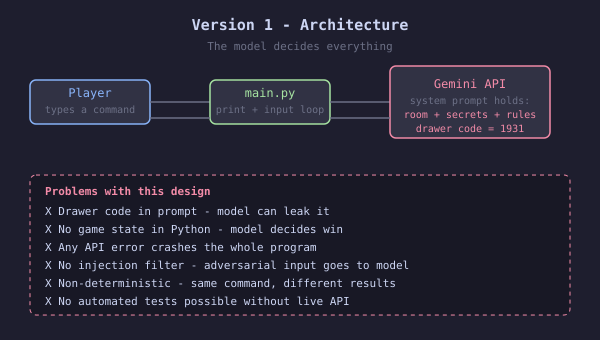
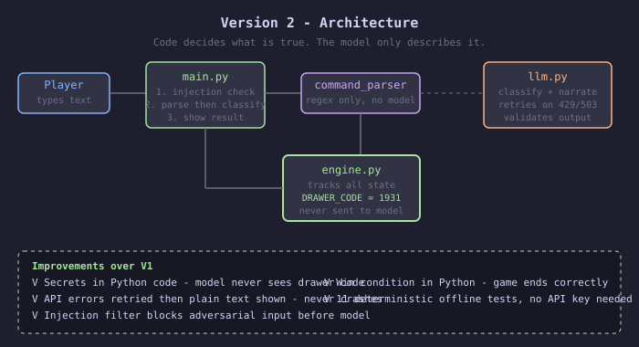

# 🕰️ AI Escape Room — Hale & Daughters

**An LLM-powered text escape room demonstrating the difference between AI-controlled game logic and deterministic, Python-controlled game logic.**

A player wakes up inside a locked watch-repair cellar. To escape, they must explore objects, discover clues, solve puzzles and unlock the door — with the help of an AI-powered narrator.

This project explores an important AI engineering question:

**What happens when we let an LLM control an entire game, and how can we make the experience more reliable by separating AI from core application logic?**

---

## 📌 Project Overview

AI Escape Room is a Python-based interactive text adventure built using Google's Gemini API.

The project contains two implementations:

- **Version 1:** The LLM controls most of the game experience, including interpreting actions and maintaining the story.
- **Version 2:** Python controls game state, puzzle rules, inventory and winning conditions. Gemini is used for natural-language command classification and storytelling.

Version 2 addresses the reliability, security and testing problems discovered during Version 1.

## ✨ Features

- Interactive text-based escape room.
- AI-powered natural-language understanding.
- Gemini-powered storytelling and narration.
- Deterministic Python game engine.
- Inventory and puzzle-state management.
- Progressive hints.
- Prompt-injection filtering.
- API error handling and retry logic.
- Offline automated tests.
- Streamlit web interface.
- Restartable game sessions.

## 🏗️ System Architecture

### Version 1 — LLM-controlled architecture

In Version 1, the player communicates through a basic Python input loop, while the Gemini model controls most of the game decisions.



**Problems identified:**
- The drawer code could leak through the system prompt.
- No reliable Python-controlled game state.
- API errors could crash the application.
- Prompt injection could affect the narrator.
- Identical commands could produce inconsistent results.
- Automated testing was difficult without a live API.

### Version 2 — Deterministic architecture

Version 2 introduces a structured command parser and a Python game engine.



**Key architectural improvements:**

| Component | Responsibility |
|---|---|
| `app.py` | Streamlit user interface and session management |
| `command_parser.py` | Command parsing and injection filtering |
| `engine.py` | Game rules, inventory, puzzle state and win conditions |
| `llm.py` | Gemini integration, classification and narration |

**Core design principle:** Python is the source of truth for game state. The LLM assists with understanding and narration but does not decide whether an action succeeds.

## 🎮 Game Design

The game takes place inside the Hale & Daughters watch-repair cellar.

The player must:

1. Examine the workbench and discover a loupe.
2. Use the loupe to reveal a hidden clue in the ledger.
3. Examine the plaque above the door.
4. Discover the year needed to unlock the drawer.
5. Retrieve the winding key.
6. Use the winding key on the music box.
7. Discover the door key.
8. Unlock the door and escape.

The game tracks inventory, puzzle progress, moves and hints used.

### Available Commands

| Command | Description |
|---|---|
| `look` | Look around the room |
| `examine <thing>` | Examine an object |
| `take <thing>` | Pick up an available item |
| `use <thing> on <thing>` | Use an item |
| `enter <code>` | Enter a drawer code |
| `inventory` | View collected items |
| `hint` | Get a progressive hint |
| `quit` | Leave the game |

## 🛠️ Technology Stack

- **Language:** Python
- **AI Model:** Google Gemini
- **AI SDK:** Google GenAI SDK
- **Web Framework:** Streamlit
- **Environment Configuration:** python-dotenv
- **Testing:** Python automated tests

## 🚀 Installation and Setup

### 1. Clone the repository

```bash
git clone https://github.com/charithkatamoni-oss/AI-Escape-Room.git

cd AI-Escape-Room
```

### 2. Create a virtual environment

```bash
python -m venv .venv
```

Activate it on macOS/Linux:

```bash
source .venv/bin/activate
```

### 3. Install dependencies

```bash
pip install -r requirements.txt
```

Ensure `streamlit` is included in `requirements.txt` before running the web application.

If it is not included, install it with:

```bash
pip install streamlit
```

### 4. Configure Gemini API

Create a `.env` file in the project root.

Add your Gemini API key:

```env
GEMINI_API_KEY=your_gemini_api_key_here
GEMINI_MODEL=gemini-3.6-flash
```

Replace the placeholder with your own API key.

Never upload your real `.env` file or API key to GitHub.

### 5. Run Version 2

```bash
streamlit run v2/app.py
```

The application will open in your browser, usually at:

```text
http://localhost:8501
```

Without a configured Gemini API key, the game can use its Python-based fallback responses.

## 🧪 Testing

Version 2 includes automated offline tests that do not require a Gemini API key or an internet connection.

Run the tests from the project root:

```bash
python v2/test_engine.py
```

**Current documented test result: 11/11 passing.**

| Test | What it validates |
|---|---|
| Full playthrough | Player can complete the game |
| Code protection | Secret drawer code is not revealed |
| Fake key claim | False inventory claims are rejected |
| Invalid objects | Invented objects are refused |
| Decoy code | Incorrect code does not unlock the drawer |
| Puzzle progression | Players cannot skip required steps |
| Inventory | Items are tracked correctly |
| Ledger clue | Loupe is required to read the clue |
| Hint system | Hints progress with game state |
| Prompt injection | Known injection patterns are blocked |
| Contextual key handling | Ambiguous key commands are resolved |

Detailed results: [Test Cases](docs/test_cases.md).

## 📂 Project Structure

```text
AI-Escape-Room/
│
├── docs/
│   ├── architecture_v1.svg
│   ├── architecture_v2.svg
│   ├── game_design.md
│   ├── test_cases.md
│   └── v1_problems.md
│
├── v1/
│   ├── main.py
│   └── test_api.py
│
├── v2/
│   ├── app.py
│   ├── command_parser.py
│   ├── engine.py
│   ├── llm.py
│   └── test_engine.py
│
├── .env.example
├── .gitignore
├── README.md
└── requirements.txt
```

## 📚 Documentation

Further technical documentation is available in the `docs/` directory:

- [Game Design](docs/game_design.md)
- [Version 1 Problems and Version 2 Fixes](docs/v1_problems.md)
- [Automated and Manual Test Cases](docs/test_cases.md)
- [Version 1 Architecture](docs/architecture_v1.svg)
- [Version 2 Architecture](docs/architecture_v2.svg)

## 🔐 Security and Reliability

Version 2 improves reliability through:

- Keeping game secrets and state inside Python.
- Validating actions against the current game state.
- Filtering known prompt-injection patterns.
- Validating structured LLM classification responses.
- Retrying selected Gemini API failures.
- Falling back to deterministic engine responses when AI narration is unavailable.

## 🎯 Project Objective

The primary objective is to demonstrate how AI applications can be designed with a clear separation between probabilistic language-model behaviour and deterministic business logic.

This project demonstrates practical concepts in:

- Large Language Model integration.
- Prompt engineering.
- Natural-language command parsing.
- Deterministic state management.
- API error handling.
- Prompt-injection mitigation.
- Automated software testing.
- Python application architecture.

## 👨‍💻 Author

**Charith Katamoni**

GitHub: [@charithkatamoni-oss](https://github.com/charithkatamoni-oss)

---

*Built as an exploration of reliable LLM-powered applications using Python and Google Gemini.*